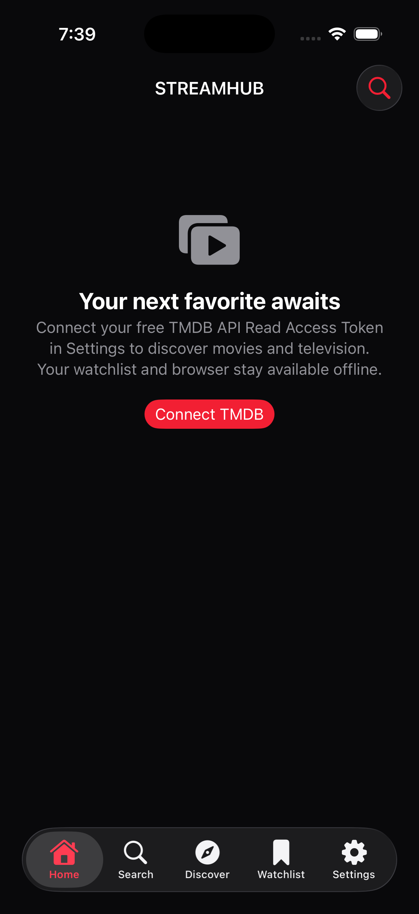

<p align="center"></p>

# StreamHub

A native, open-source iOS movie and television discovery app. Explore cinematic artwork, save a watchlist, browse viewing options, and play compatible streams you are authorized to access. Original SwiftUI interface, black surfaces, red accents, and no advertising.

**Development status:** [0.1.1 is published](https://github.com/naahs-lawragga/StreamHub-IOS/releases/tag/v0.1.1), with guided TMDB setup and a [live AltStore/SideStore source](https://naahs-lawragga.github.io/StreamHub-IOS/source.json). Its [release build](https://github.com/naahs-lawragga/StreamHub-IOS/actions/runs/40386876850) passed 39 Swift tests and 11 release-tool tests on 2026-10-26. This is an early development release. SideStore, LiveContainer, iPhone 17 ProMotion performance, and multitasking require device testing; compatibility is not certified.

## Features

- Home, Search, Discover, Watchlist, and Settings tabs with Dynamic Type and accessibility support.
- Official TMDB trending, popular and top-rated feeds; debounced search; movie and TV details, cast, trailers, seasons and episodes.
- A five-step TMDB setup tutorial with copyable application details, read access token guidance, and iPhone troubleshooting.
- Local watchlist, recently viewed titles, search history, and supported native playback progress.
- Regional provider listings with explicit title-level scope, a persistent WKWebView browser, favorites, and user-managed sources.
- AVPlayer playback of compatible authorized HTTPS HLS/MP4, system controls, audio/subtitle selection, and Picture-in-Picture where supported.
- Optional cached FMHY directory browsing. Directory links do not verify a title's availability.
- Validated update metadata, version comparison, dismissed-version persistence, and SideStore/LiveContainer tutorials.

## Get started

[Download StreamHub 0.1.1](https://github.com/naahs-lawragga/StreamHub-IOS/releases/download/v0.1.1/StreamHub-unsigned.ipa), then sign or import the IPA with a compatible installation tool. For SideStore, add `https://naahs-lawragga.github.io/StreamHub-IOS/source.json` in Sources. See [installation instructions](docs/INSTALLATION.md).

Use iOS 17 or later. In version 0.1.1, open **Settings → TMDB connection → Set up TMDB step by step**. The guide explains account setup, the application form, and how to copy your [TMDB API Read Access Token](https://www.themoviedb.org/settings/api). Paste the complete token into the secure connection field and tap **Save token**. Use the read access token, without adding `Bearer`; the separate API Key (v3 auth) is not accepted by this field. The token stays in the device Keychain and is never required in GitHub Actions. Individual viewing providers may require their own accounts.

On Windows, place the checkout at `C:\iOSProjects\StreamHub`. Edit with Visual Studio Code and push approved changes to GitHub. GitHub Actions supplies the macOS/Xcode build environment. See [building](docs/BUILDING.md) and [installation](docs/INSTALLATION.md).

After a successful **Build unsigned IPA** run, download the `StreamHub-unsigned-<commit>` artifact from the run's Summary page. Extract the ZIP to obtain `StreamHub-unsigned.ipa` and its checksum. The IPA must be signed or imported by a compatible installation tool; it is not an App Store distribution.

## Screenshots



Actual simulator capture from the published 0.1.1 build. No TMDB token was installed; this shows the real setup state. Movie artwork loads from TMDB after configuration. See the [build report](docs/BUILD_REPORT.md) for validation evidence and remaining limitations.

## Build and test

On macOS with Xcode 26.3, a matching iOS simulator, and XcodeGen 2.42.0:

```sh
swift test --package-path Core
bash scripts/build-ios.sh
```

The script generates `StreamHub.xcodeproj`, resolves the local Swift package, runs core and iOS tests, captures the simulator, builds for iPhoneOS, validates the bundle, and packages `build/StreamHub-unsigned.ipa`.

## Releases and updates

Ordinary main-branch pushes produce artifacts. The [0.1.1 release](https://github.com/naahs-lawragga/StreamHub-IOS/releases/tag/v0.1.1) includes the unsigned IPA, SHA-256 checksum, and release notes. Add the live source `https://naahs-lawragga.github.io/StreamHub-IOS/source.json` to SideStore or a compatible AltStore client.

The source is generated from public IPA downloads whose checksum, size, bundle identity, and version have been verified. A separate Pages workflow revalidates the source before deployment. Version 0.1.1 is configured to check this URL while in use; the original 0.1.0 IPA must be updated manually because it has no configured source URL. See [installation](docs/INSTALLATION.md) and [releases](docs/RELEASING.md).

## Compatibility and roadmap

See the [device test matrix](docs/COMPATIBILITY.md). WKWebView cannot guarantee support for every provider; access controls and DRM remain in force. Native playback progress applies only to AVPlayer sessions. The app does not extract protected streams, claim FMHY title availability, or bypass signing.

Milestones: 0.1 discovery and first successful IPA; 0.2 browser and player hardening; 0.3 directory/providers/resume; 0.4 measured performance and LiveContainer validation; 1.0 device-tested polish and approved public release. Features may land ahead of their validation milestone.

## Contributing and credits

Read [CONTRIBUTING](CONTRIBUTING.md), [SECURITY](SECURITY.md), and [third-party notices](docs/THIRD_PARTY.md). This product uses the TMDB API but is not endorsed or certified by TMDB. Watch-provider information originates from TMDB/JustWatch. FMHY is an independent website directory. StreamHub is unaffiliated with these services, SideStore, LiveContainer, Netflix, or Apple.

Original code and StreamHub artwork use the [MIT license](LICENSE). Third-party material retains its own terms.
